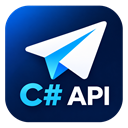

# Telegram Bot API (C#)
[](https://core.telegram.org/bots/api#november-9-2026)
[](#runtime-compatibility)
[](https://www.nuget.org/packages/Endfix.Telegram.BotAPI/)

Typed .NET client for the Telegram Bot API. The package provides native
`net8.0` and compatible `netstandard2.0` assets and uses `System.Text.Json` for
request and response contracts.

## Table of contents

- [Status](#status)
- [Key capabilities and limitations](#key-capabilities-and-limitations)
- [Installation](#installation)
- [Quick start](#quick-start)
- [Complete minimal bot](#complete-minimal-bot)
- [Receiving updates](#receiving-updates)
- [Files](#files)
- [Custom requests](#custom-requests)
- [Production usage](#production-usage)
- [Behavior and guarantees](#behavior-and-guarantees)
- [Runtime compatibility](#runtime-compatibility)
- [Documentation](#documentation)
- [Development](#development)
- [License](#license)

## Status

This package is a strongly typed, low-level client for the
[Telegram Bot API](https://core.telegram.org/bots/api): methods, parameters,
types, transport, and errors. Applications keep control of polling and webhook
lifetime, as shown in the examples.

Version `2.0` follows Bot API `10.4` and freezes the public contract:
incompatible changes require a major version, while new Bot API methods and
additive models are minor versions. If you want an application framework with
routing or dialogs, see Telegram's list of community
[.NET Bot API libraries](https://core.telegram.org/bots/samples#net).

See [CHANGELOG.md](https://github.com/endfix/telegram-bot-api/blob/main/CHANGELOG.md) for release notes and unreleased changes. Upgrading from `1.x`? See the [migration guide](https://github.com/endfix/telegram-bot-api/blob/main/docs/migrating-to-2.0.md).

## Key capabilities and limitations

| Capability | What you get | Limitations |
| --- | --- | --- |
| Typed API surface | Methods, parameters and response models for Bot API `10.4`, with XML documentation and snake-case JSON. | New Telegram methods and fields arrive in subsequent releases; helpers cover the methods exposed by the package. |
| Union types | Polymorphic `System.Text.Json` converters for chat members, media, rich text, gifts and other Telegram unions. | Reflection-based serialization; no source generation, trimming, or Native AOT guarantee. |
| Requests | JSON bodies for no-file methods; automatic `multipart/form-data` when a file source appears anywhere in the parameter graph. | Upload content must be replayable for each attempt; Telegram method and file-size limits apply. |
| Files | Lazy path sources, byte snapshots, stream factories, buffered `byte[]` downloads and streaming downloads. | Uploads are not resumed after a transport failure; the application supplies storage and network infrastructure. |
| Long polling | Sequential FIFO or bounded-parallel processing, with automatic `429` and transient polling retries. | Best-effort delivery: no persisted offset or durable at-least-once guarantee. |
| Webhooks | Plain `Update` deserialization and guidance for validating `X-Telegram-Bot-Api-Secret-Token`. | The application owns the HTTPS endpoint, hosting and web-server lifetime. |
| Errors and retries | `RequestAsync` returns the Telegram envelope; `ExecuteAsync` throws `ApiRequestException`; only `429` is retried automatically by `RequestAsync`. | Timeouts, cancellation, transport failures and other API errors surface to the caller. |
| Hosting | Works with any `HttpClient` and DI container without host coupling. | Not a bot framework: no routing, dialogs, state, middleware, or DI integration package. |
| Local cost | Reference snapshot on a local transport: 531 ns and 264 B to serialize parameters, 3.7 us and 3.8 KB per request with deserialization. | Benchmarks exclude Telegram and network latency, and the figures are machine-specific. |

## Installation

```bash
dotnet add package Endfix.Telegram.BotAPI
```

Packages follow semantic versioning. Pin `--version <x.y.z>` when you need a
reproducible build.

## Quick start

Each bot is given a unique authentication token [when it is created](https://core.telegram.org/bots/features#botfather). Store the token in User Secrets or an environment variable; do not put it in `appsettings.json` or source control. You can learn about obtaining tokens and generating new ones in [this document](https://core.telegram.org/bots/features#botfather).

```cs
using var httpClient = new HttpClient(new SocketsHttpHandler
{
    PooledConnectionLifetime = TimeSpan.FromSeconds(5),
    MaxConnectionsPerServer = 10
})
{
    Timeout = TimeSpan.FromMinutes(5)
};

using var api = new BotApiClient(
    "<token>",
    httpClient);

var message = await api.SendMessageAsync(
    chatId: 1234567890,
    text: "Hello from Endfix.Telegram.BotAPI");
```

Custom Bot API base URLs may include a path prefix. For example, passing
`https://example.com/telegram/` as `url` sends API requests below that path;
the trailing slash is optional.

## Complete minimal bot

A complete console application that echoes text messages. Create a .NET 8
console project with implicit usings enabled, add the package, set
`TELEGRAM_BOT_TOKEN`, and run:

```cs
using Endfix.Telegram.BotAPI;
using Endfix.Telegram.BotAPI.Extensions;

var token = Environment.GetEnvironmentVariable("TELEGRAM_BOT_TOKEN")
    ?? throw new InvalidOperationException("Set TELEGRAM_BOT_TOKEN.");

using var api = new BotApiClient(token);

api.OnUpdate += async (client, update, cancellationToken) =>
{
    if (update.Message?.Text is not { } text)
    {
        return;
    }

    await client.SendMessageAsync(
        update.Message.Chat.Id,
        $"Echo: {text}",
        cancellationToken: cancellationToken);
};

using var stopping = new CancellationTokenSource();
Console.CancelKeyPress += (_, eventArgs) =>
{
    eventArgs.Cancel = true;
    stopping.Cancel();
};

await api.StartPollingAsync(cancellationToken: stopping.Token);
```

The [Long Polling example](https://github.com/endfix/telegram-bot-api/tree/main/Telegram.BotAPI.Examples/LongPolling) adds logging, hosted lifetime and scope-per-update processing. The [Webhook example](https://github.com/endfix/telegram-bot-api/tree/main/Telegram.BotAPI.Examples/Webhook) shows the ASP.NET Core equivalent.

## Receiving updates

Long polling delivers updates through `OnUpdate`. With `maxParallel = 1`,
updates are processed sequentially in FIFO order; higher values process updates
concurrently and do not guarantee start or completion order. Use sequential
processing for stateful workflows that depend on update ordering.

For webhooks, deserialize an `Update` at an HTTPS endpoint and validate
Telegram's `X-Telegram-Bot-Api-Secret-Token` header before processing it. Both
receiving models are shown in the [complete examples](https://github.com/endfix/telegram-bot-api/tree/main/Telegram.BotAPI.Examples).

## Files

Typed input files accept a local path or a repeatable `InputFileSource`. Path
sources are lazy and do not buffer the file, `FromMemory` takes a snapshot of
the supplied bytes, and `FromStream` returns a fresh stream for every request
attempt. The library owns and disposes streams consumed by a request.

```cs
var document = new InputDocumentFile("report.pdf");
await api.SendDocumentAsync(chatId: 1234567890, document: document);
```

Prefer `InputFileSource.FromMemory(reportBytes, "report.pdf")` when the bytes
are already loaded, or `InputFileSource.FromStream(() => storage.OpenRead(path), "name.pdf")`
for databases, object storage and generated content. Each factory call must
return an independent readable stream with equivalent content.

To download a file, request its path and stream the response:

```cs
var message = await api.SendDocumentAsync(
    chatId: 1234567890,
    document: new InputDocumentFile("report.pdf"));

var file = await api.GetFileAsync(message.Document!.FileId);
await using var destination = File.Create("downloaded-report.pdf");
await api.DownloadFileAsync(file.FilePath!, destination);
```

Use `GetFileBytesAsync` when a buffered `byte[]` is more convenient. Bots can
download files of up to 20 MB. Both download methods reject absolute paths,
parent-directory segments, query strings, fragments, and backslashes.

See the [Files guide](https://github.com/endfix/telegram-bot-api/blob/main/docs/files.md) for the complete source and ownership rules.

## Custom requests

The typed helpers cover the Bot API methods exposed by the package. For a
method or parameter shape that is not wrapped yet, derive from
`ApiRequestParameters` and send it through `RequestAsync` or `ExecuteAsync`:

```cs
using Endfix.Telegram.BotAPI.Enums;
using Endfix.Telegram.BotAPI.Protocol;
using Endfix.Telegram.BotAPI.Types;

public sealed class CustomSendMessageParameters : ApiRequestParameters
{
    public required ChatIdSource ChatId { get; init; }
    public required string Text { get; init; }
    public ParseMode? ParseMode { get; init; }
}

var response = await api.RequestAsync<Message>(new ApiRequest(
    "sendMessage",
    new CustomSendMessageParameters
    {
        ChatId = 123456789L,
        Text = "Hello from custom parameters",
        ParseMode = ParseMode.HTML
    }));
```

Properties use the same snake-case policy and converters as the built-in
parameter types. Null values are omitted and `[JsonPropertyName]` is not
required. Use `ExecuteAsync` when an unsuccessful response should throw
`ApiRequestException`. An `InputFile` or `IFileSource` anywhere in the parameter
graph switches the request to `multipart/form-data` and replaces nested files
with `attach://` references automatically.

See the [custom requests guide](https://github.com/endfix/telegram-bot-api/blob/main/docs/custom-requests.md) for the multipart example and naming rules.

## Production usage

Use one singleton `IBotApiClient` per bot. In hosted applications, let a
singleton `BackgroundService` own `StartPollingAsync`, subscribe when the service
starts, unsubscribe in `finally`, and create a DI scope inside the event callback
before resolving scoped handlers or database contexts. Never subscribe a scoped
or transient object directly to the singleton client's `OnUpdate` event.

A supplied `HttpClient` remains owned by the caller and should normally be
reused for the application's lifetime. `BotApiClient` disposes the `HttpClient`
only when it created that client internally.

The Long Polling and Webhook examples demonstrate this lifetime with one
singleton `IBotApiClient` per bot, a supplied singleton `HttpClient`, and a new
async DI scope per update.

## Behavior and guarantees

- `RequestAsync` returns the envelope instead of throwing when Telegram reports
  an API error; `ExecuteAsync` and the typed helpers throw `ApiRequestException`,
  which exposes `ErrorCode` and carries Telegram's description in `Message`.
- Long polling is best effort: a failing `OnUpdate` subscriber is logged, later
  subscribers still run, and an interrupted session may receive an update again
  even after its handler ran.
- Only one polling session can run per client; `Dispose` cancels it and rejects
  new requests with `ObjectDisposedException`.
- Upload sources open a fresh stream for each attempt, and the library disposes
  streams it consumes. A supplied `HttpClient` is never disposed.

See the [behavior and guarantees guide](https://github.com/endfix/telegram-bot-api/blob/main/docs/behavior.md) for the complete tested contract, including retry and delivery semantics.

## Runtime compatibility

The package targets `net8.0` and `netstandard2.0`. NuGet selects the native
`net8.0` asset for .NET 8 and later applications; older runtimes use the
compatible `netstandard2.0` fallback.

| Consumer target | Asset | Status |
| --- | --- | --- |
| `.NET 8`, `.NET 9`, `.NET 10` | `net8.0` | Supported; recommended for new applications. |
| `.NET 6`, `.NET 7` | `netstandard2.0` | Compatible, but these runtimes are out of support. |
| `.NET Framework 4.7.2` through `4.8.1` | `netstandard2.0` | Compatible; practical for maintained classic Windows applications. |
| `.NET 5`, `.NET Core 3.1` | `netstandard2.0` | NuGet asset compatibility only; not exercised or supported. |
| `.NET Framework 4.6.1` through `4.7.1` | `netstandard2.0` | Package-dependent; may resolve, but is not a recommended baseline. |

.NET 8 and later consumers use the runtime-provided `System.Text.Json`; the
`netstandard2.0` fallback brings its own compatible dependency graph. The
package does not claim trimming or Native AOT compatibility.

See the [compatibility guide](https://github.com/endfix/telegram-bot-api/blob/main/docs/compatibility.md) for the full table, dependency footprint, and runtime notes.

## Documentation

| Document | Contents |
| --- | --- |
| [Compatibility](https://github.com/endfix/telegram-bot-api/blob/main/docs/compatibility.md) | Complete consumer-target table, dependency footprint, and trimming/AOT expectations. |
| [Behavior and guarantees](https://github.com/endfix/telegram-bot-api/blob/main/docs/behavior.md) | Tested runtime contract for errors, retries, polling, delivery, and ownership. |
| [Files](https://github.com/endfix/telegram-bot-api/blob/main/docs/files.md) | Upload sources, stream ownership, retries, and download semantics. |
| [Custom requests](https://github.com/endfix/telegram-bot-api/blob/main/docs/custom-requests.md) | Custom parameters, JSON naming, multipart switching, and `attach://` references. |
| [Migrating from 1.x to 2.0](https://github.com/endfix/telegram-bot-api/blob/main/docs/migrating-to-2.0.md) | Intentional breaking changes in the 2.0 release. |
| [Development](https://github.com/endfix/telegram-bot-api/blob/main/docs/development.md) | Build requirements, test commands, package smoke tests, benchmarks, and the release process. |
| [Examples](https://github.com/endfix/telegram-bot-api/tree/main/Telegram.BotAPI.Examples) | Long polling, webhook, and Mini App projects. |

Release notes and unreleased changes are in [CHANGELOG.md](https://github.com/endfix/telegram-bot-api/blob/main/CHANGELOG.md).

## Development

Repository builds are pinned to .NET SDK `9.0.317` through `global.json`. The
solution also runs `net8.0` tests and examples, so install the .NET 8 SDK
alongside SDK 9 when working locally.

```bash
dotnet test Telegram.BotAPI.sln
dotnet test Telegram.BotAPI.Tests/Telegram.BotAPI.Tests.csproj --filter "Category!=Integration"
```

Live integration tests are skipped unless a dedicated test bot is configured.
See the [development guide](https://github.com/endfix/telegram-bot-api/blob/main/docs/development.md) for the live test topology, package smoke tests, benchmarks, API documentation sources, and the release process.

## License

This project is licensed under the [MIT License](https://github.com/endfix/telegram-bot-api/blob/main/LICENSE).
